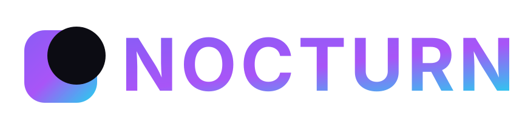
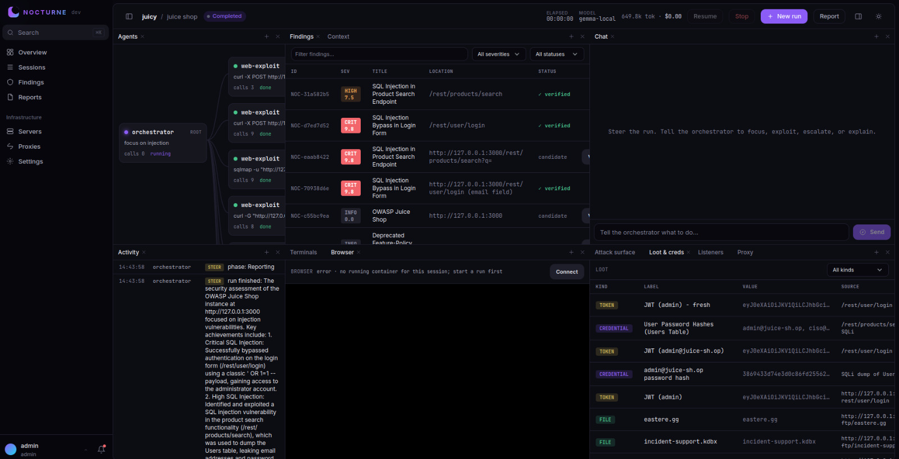
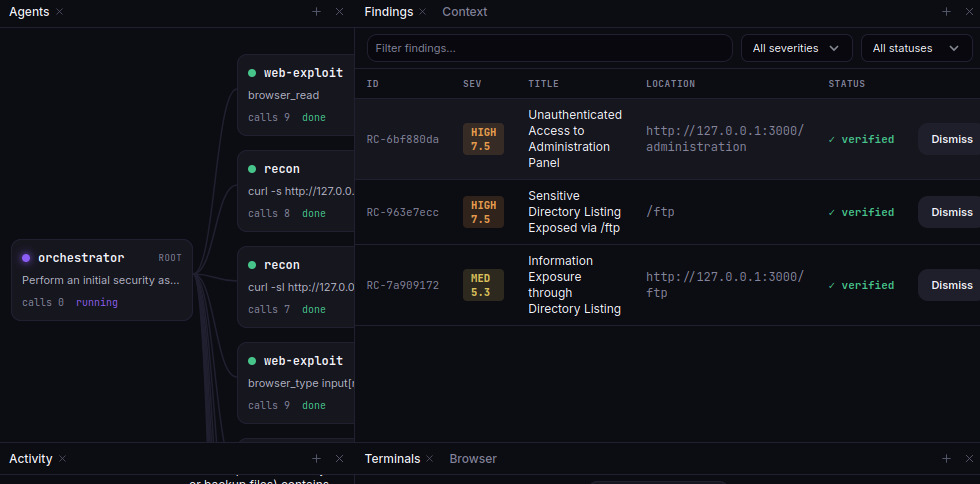
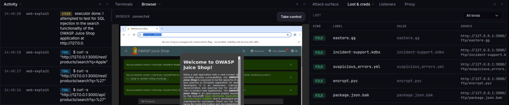
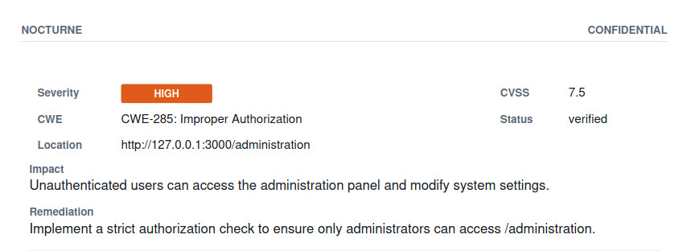
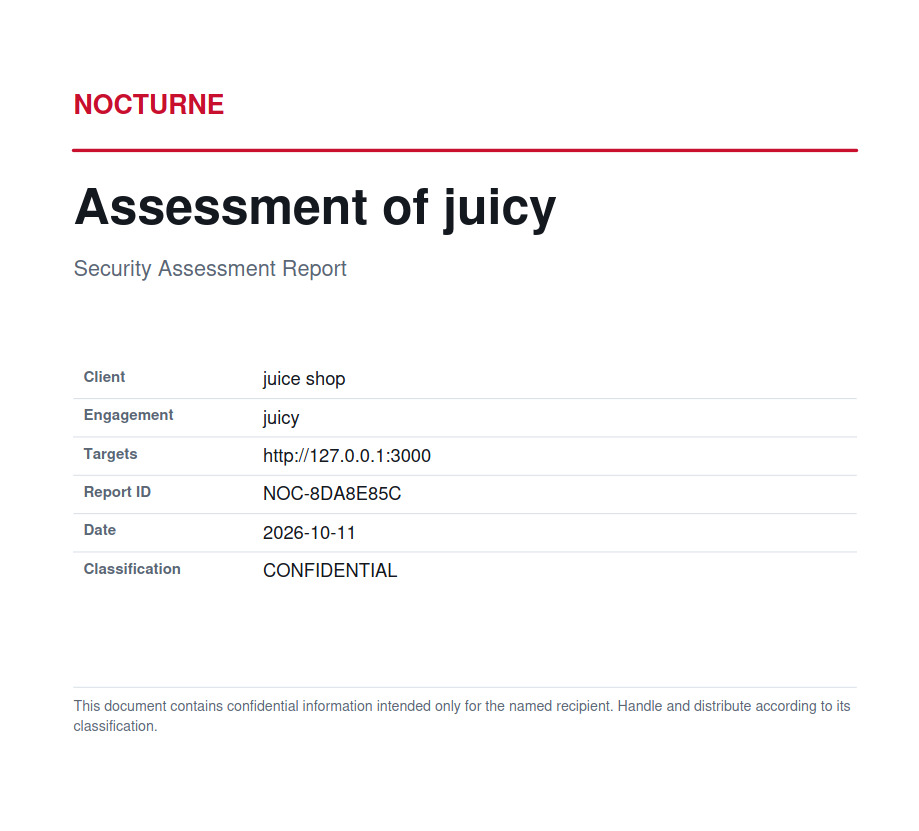
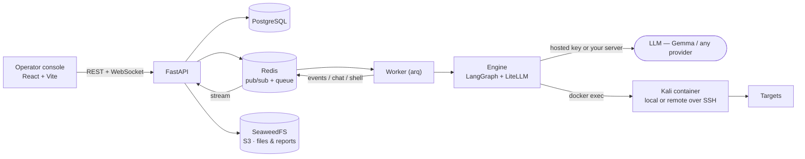

<p align="center">
  
</p>

<p align="center">
  <a href="https://github.com/NullClassifier/nocturne">
    
  </a>
</p>

<p align="center">
  
  
  
  
  
  
  
</p>

<p align="center">
  <b>Agent-assisted security assessments, with operator control, open-model flexibility, and structured reporting.</b>
</p>

> [!WARNING]
> NOCTURNE is for education, research, and **legal, authorized security testing only**. Use it only against systems you own or have explicit written permission to test, within an agreed scope. Unauthorized access to or interference with computer systems is a crime in most jurisdictions. How you use it, and staying within the law, is entirely your responsibility.

---

<p align="center">
  <a href="https://nocturne-main.netlify.app/?demo=1"><strong>Explore the interactive demo</strong></a>
  · <a href="#quickstart">Run locally</a>
  · <a href="#architecture">Architecture</a>
  · <a href="#team--contributors">Team</a>
</p>

> [!NOTE]
> **The public demo is a simulation.** It uses mock data and simulated agent activity; it does **not** run penetration tests, invoke live AI models, or connect to an operational security backend.

<p align="center">
  
</p>

## Interactive demo

**[Launch NOCTURNE — interactive simulated demo](https://nocturne-main.netlify.app/?demo=1)**

The public Netlify deployment lets visitors explore the operator interface without installing the backend, configuring model API keys, or running security tools. The link opens in demo mode and uses the frontend's in-memory mock client. Sessions, agent activity, security findings, and other sample content are **illustrative**, not the results of a live assessment.

To run the same frontend-only experience locally:

```bash
# From the repository root
bun install
bun --filter @nocturne/web dev
```

Open **http://localhost:5183/?demo=1**. The frontend defaults to `VITE_API_MODE=mock` unless configured otherwise. Production use requires the real backend and an explicitly authorized testing environment.

## What it is

NOCTURNE is an open-source, agent-assisted security assessment platform built for **authorized testing**. An LLM-based orchestrator plans an engagement and delegates tasks to executor agents. In live mode, those agents can use security tools in an isolated Kali container; the human operator defines the scope, watches activity, and can steer or stop the run.

The operator console combines chat, a live agent graph and event feed, an agent-controlled browser view, terminals, findings triage, and report generation. Run checkpoints support recovery after interruption.

Model access is **provider-agnostic** through LiteLLM: use a supported hosted endpoint or a self-hosted OpenAI-compatible model server. See [Models](#models) for configuration details.

**Potential users:** independent penetration testers, small security consultancies, and internal security teams seeking a clearer way to coordinate repetitive steps in authorized assessments. A managed or hosted offering is a possible business direction, **not** a claim of current paying customers.

## Features

| | |
|---|---|
| 🧠 **Multi-agent engine** | A LangGraph plan/act loop. The orchestrator delegates objectives to executor agents that run tools and record findings, loot, and hosts as they work. |
| 🛠️ **Structured tools** | Dedicated tools for nmap, nuclei, directory/vhost discovery, and Metasploit. Each parses its own output into the attack surface or findings — a scan records hosts and vulns with no follow-up step. `run_command` covers the rest. |
| 🐳 **Real execution** | Tools run in a Kali container over `docker exec`, local or on a saved server over SSH. |
| 🌐 **Agent browser** | For login flows and JS-heavy apps, an agent drives a real Chromium in the container. Watch it live over noVNC, take control, hand it back. |
| 🐚 **Reverse shells** | An agent opens a listener, catches the shell, and gives you an interactive terminal — or open your own. |
| 🔀 **Network pivoting** | Route tool traffic through a caught foothold with a chisel reverse SOCKS tunnel; nmap runs through it automatically. |
| 💬 **Chat drives the run** | Tell the chat what you want and it steers the live orchestrator, or reopens a finished run to take on new work. |
| 🔎 **Code-scan sessions** | Point a session at a git repo or local folder for a source review, findings mapped to file:line. |
| ✅ **Findings triage** | Verify, dismiss, and merge duplicate findings. Each gets a stable `NOC-xxxxxxxx` code; the report reflects your triage. |
| 📄 **Reports** | Export PDF + JSON + SARIF, with an executive summary, methodology, findings, and prioritized remediation. |
| 📡 **Live console** | Activity feed, terminals, and the agent browser stream over WebSockets; graphs, findings, and loot refresh on a short poll. |

## Screenshots

<p align="center">
  
  
</p>
<p align="center">
  
  
</p>

## Architecture



The API does not run agents. It queues a run, the worker executes it, and the worker publishes output onto Redis channels that the API relays to the browser over WebSockets.

## Stack

Python 3.12 · FastAPI · async SQLAlchemy + asyncpg · Alembic · arq · LangGraph · LiteLLM · ReportLab · PostgreSQL · Redis · SeaweedFS (S3) · asyncssh. **Frontend:** React 18 · Vite · TypeScript · Tailwind · TanStack Query · xterm · noVNC. **Tooling:** `uv` (Python), `bun` (frontend).

## Quickstart

This starts the **full local development stack**, unlike the frontend-only public demo. You will need [Docker](https://docs.docker.com/get-docker/), [uv](https://docs.astral.sh/uv/), and [bun](https://bun.sh/). Run all commands from the repository root unless stated otherwise.

```bash
# 1. Copy the development configuration
cp .env.example .env

# 2. Start local infrastructure (PostgreSQL, Redis, S3-compatible storage)
docker compose -f docker-compose.dev.yml up -d

# 3. Install Python dependencies and prepare the database
uv sync --group live
uv run noct db upgrade
uv run noct seed

# 4. Install frontend dependencies
bun install
```

In **three separate terminals** (each starting from the repository root):

```bash
# Terminal 1 — API
cd apps/api && uv run uvicorn app.main:app --host 127.0.0.1 --port 8080

# Terminal 2 — worker
cd apps/worker && uv run arq worker.settings.WorkerSettings

# Terminal 3 — operator UI
cd apps/web && bun run dev
```

Open **http://localhost:5183**. The seeded development credentials are `admin` / `admin` — **local development only**. Change default credentials before any network-accessible deployment.

> [!CAUTION]
> The backend defaults to live execution and can run real tools. Use **only** with targets you own or have written permission to test. To inspect the backend-supported simulation without real security-tool execution, set `NOCTURNE_RUN_MODE=sim` in `.env`. For the simpler UI-only demo with no backend, use the [interactive demo](#interactive-demo).

### Practice targets

Intentionally vulnerable apps to aim NOCTURNE at, all local:

```bash
docker compose -f docker-compose.targets.yml up -d
# DVWA http://localhost:8081 · Juice Shop http://localhost:3000 · WebGoat http://localhost:8082
```

## Models

During our own runs, the agents used a **self-hosted Gemma model configured locally** on our own infrastructure. That setup is specific to our environment and intentionally not part of this repository — so for **full reproducibility**, NOCTURNE ships provider-agnostic model access. Open **Settings → Providers & keys**, pick one, and paste a key:

| Option | What you need | Notes |
|---|---|---|
| **Google AI Studio (Gemma)** | A free key from [aistudio.google.com/apikey](https://aistudio.google.com/apikey) | Gemma 4 supports the tool calling the agent loop needs. Easiest "paste and go." |
| **OpenRouter (Gemma)** | A key from [openrouter.ai/keys](https://openrouter.ai/keys) | Hosts Gemma 4 / 3. Use the paid model (not `:free`) so a tool-capable provider is selected. |
| **Internal / custom endpoint** | Base URL + key + model name | Any OpenAI-compatible server — your own vLLM, LM Studio, a proxy. Enter the endpoint right in the key dialog. |

> No key? `NOCTURNE_RUN_MODE=sim` streams canned data so you can tour the entire UI before wiring up a model.

Keys are stored in the database, encrypted at rest. Cost and token usage for a run are metered live in the console header (self-hosted endpoints are billed at $0).

## Deploy (self-host)

The full deployment is separate from the public Netlify demo. The bundled deployment uses Docker Compose and a Caddy reverse proxy so the web app and API share an origin. HTTPS is available when correctly configured with a domain:

```bash
git clone https://github.com/NullClassifier/nocturne.git
cd nocturne
./deploy.sh
```

The script can install Docker if missing and asks how NOCTURNE should be reached (direct IP, a domain with automatic Let's Encrypt, or behind an existing proxy). It writes deployment configuration, pulls images, and starts the stack. By default, only ports 80/443 are exposed by the Compose deployment; backing services remain on the internal network. See [docs/DEPLOY.md](docs/DEPLOY.md).

**Do not expose a live instance with development credentials or unrestricted targets.** Configure strong credentials, secrets, HTTPS, a restrictive assessment scope, and access controls before making any service reachable from the Internet. See [Hardening](docs/HARDENING.md).

## Configuration

Backend config is one root `.env` (see [`.env.example`](.env.example)), read by the API and worker:

- `NOCTURNE_RUN_MODE` — `live` (default) or `sim`.
- `NOCTURNE_DATABASE_URL`, `NOCTURNE_REDIS_URL`, `NOCTURNE_S3_*` — infrastructure.
- `NOCTURNE_SECRET_KEY` — Fernet key for encrypting stored credentials. Set a real one before production.

Provider keys, the execution image, scope guardrails, and report branding live in the Settings page, stored in the database and encrypted where needed.

## Project layout

```
apps/
  api/                 FastAPI: routers, WebSocket streams, auth
  worker/              arq worker: runs engagements and report generation
  web/                 React operator console
packages/
  core/nocturne_core/  engine, models, repositories, storage, bus, reporting
  api-client/          the single typed client the UI talks to (mock + HTTP)
docker/                Kali execution image, web/api images, Caddy & S3 config
docker-compose.dev.yml       Postgres + Redis + S3 (dev infra)
docker-compose.yml           full stack behind a Caddy reverse proxy (self-host)
docker-compose.targets.yml   local vulnerable targets
deploy.sh                    interactive self-host deploy
```

## Documentation

- [Architecture](docs/ARCHITECTURE.md) — components, how a run flows, cross-process coordination.
- [Hardening & threat model](docs/HARDENING.md) — deploy safely: secrets, scope, data retention.
- [Pre-authentication surface](docs/PRE-AUTH-SURFACE.md) — what an unauthenticated client can observe.
- [Cost & token accounting](docs/COST.md) — how run spend is measured.
- [Command palette & shortcuts](docs/SHORTCUTS.md) · [Updating](docs/UPDATING.md) · [Console shell](docs/APP-SHELL.md) · [Form controls](docs/FORMS.md)

## Hacktoberfest 2026: Week 2 development

NOCTURNE builds on an earlier prototype; its complete codebase was **not** created during the October 12–18 challenge period. During that period, the team made documented improvements including:

- Additional provider configuration options for Google AI Studio, OpenRouter, and custom OpenAI-compatible endpoints.
- Usage and cost metering for supported hosted Gemma models.
- Reproducible local object storage using SeaweedFS.
- Updates to the model-selection interface and setup documentation.

The repository's public commit history records these changes and the earlier foundation. The frontend-only public demo is provided to make the operator experience easy to explore; it should not be confused with a live Gemma-powered pentest.

## Team & contributors

NOCTURNE is a collaborative project developed by the **Netrunners team**.

- [**@NullClassifier**](https://github.com/NullClassifier) — developer and repository maintainer.
- [**@ismayilysfli**](https://github.com/ismayilysfli) — developer and project collaborator.

Contributions have also been exchanged outside GitHub and integrated into the repository by a teammate, so commit authorship is not intended to be a complete record of who worked on the project.

## Contributing

Contributions, bug reports, and documentation improvements are welcome. See [CONTRIBUTING.md](CONTRIBUTING.md) for setup, tests, and conventions, and the [Code of Conduct](CODE_OF_CONDUCT.md). Report security issues privately per [SECURITY.md](SECURITY.md), not public issues.

## Legal notice and responsible use

NOCTURNE is intended **solely for education, research, and legal, authorized security testing** — your own systems and labs, deliberately vulnerable practice targets, CTF events, and engagements you are contracted to perform with the target owner's explicit written permission and a defined scope.

Do **not** use NOCTURNE against any system, network, account, or data you do not own or are not clearly authorized in writing to test. Testing without authorization is illegal under laws including the Budapest Convention and its parties, EU Directive 2013/40/EU, the UK Computer Misuse Act 1990, and the US Computer Fraud and Abuse Act (18 U.S.C. § 1030). Wherever you are, and wherever the target is, unauthorized testing is very likely a crime.

You are solely responsible for obtaining authorization, staying within scope, and complying with all applicable laws, contracts, rules of engagement, and provider terms. Get written permission before you test, and keep a copy. NOCTURNE is provided "as is", without warranty of any kind; the authors accept no liability for any damage, loss, or legal consequence arising from its use or misuse.
